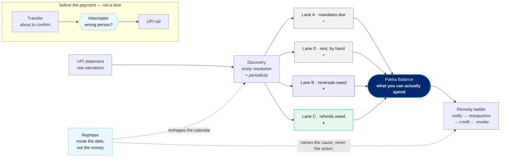

# Pakka — Forward Obligation Engine

> Your balance does not know what it already owes.

A payment app shows you one number: **Balance: ₹39,267**. That number does not
know that ₹14,518 of it is already promised to seven standing mandates, that
one of them presents on the 5th while your salary lands on the 7th, that a
pending debit from Tuesday has not settled yet, or that the rent goes out on
the 2nd and no register anywhere has heard of it.

Pakka is the missing primitive: a live ledger of money that is **committed but
not settled**.

```
Pakka Balance = bank balance
              − committed outflows    (mandates due in horizon)      ← Lane A
              − recurring commitments (rent and the like, by hand)   ← Lane D
              + expected reversals    (pending debits coming back)   ← Lane B
              + expected inbound      (refunds arriving in time)     ← Lane C
```

And one gate in front of the payment itself: **is this going to the person you
meant** — a typo'd VPA, or the wrong Sharma — caught in the seconds before
confirm rather than chased afterwards.

Then one question none of that asks: **why is the money due on that day at
all?** Every lane above moves money to meet a fixed date. The rephaser
moves the date.

Built for the Paytm "Build for India" AI Hackathon, Theme 1 (AI for Paytm
Users).

---

## How it is put together



Four lanes net into one number; a graduated ladder acts on it. Two things sit
outside that path on purpose. The **interceptor** is a gate in the seconds
before confirm and never touches the ledger. The **rephaser** reshapes the
debit calendar the lanes are computed against — it is not a lane, and not a
rung on the ladder either, because a mandate cannot be modified within two
days of presenting and the ladder speaks 24 hours out.

## Why this matters

Under NPCI's UPI AutoPay operating guidelines, a **first-presentation failure
revokes the mandate** rather than retrying it. It does not take a crisis to
trigger one — it takes a calendar. Ramesh, the cohort's headline persona, has
four mandates presenting on the 5th and a salary that lands on the 7th: he is
short for two days of every single month. When one of those debits fails it is
not a late payment — it is a SIP, an insurance premium or an EMI that
**silently died** over a few hundred rupees on the wrong morning. Most people
find out months later.

> **On the industry figures.** Earlier drafts led with ~20M revocations a month
> and ~95M active mandates. Both are secondary: the revocation figure is press
> reporting of NPCI data, and the ~95M active-mandate figure could not be
> traced to a primary source at all — NPCI's own AutoPay ecosystem statistics
> page currently 404s, and the widely-repeated version travels with a companion
> claim (~4.2 crore executions a month) that contradicts the better-sourced
> execution counts by more than an order of magnitude. They are kept as context
> and clearly marked, but nothing here rests on them; every figure this project
> argues from is measured on the cohort and regenerable with one command.

RBI's e-mandate framework also requires a pre-debit notification at least 24
hours before every debit. That is a guaranteed intervention window, and today
it is a passive alert rather than a trigger.

> ⚠️ **Verify before pitching.** The auto-revocation rule is the load-bearing
> premise of this project and was taken from secondary sources. Confirm it
> directly against NPCI's AutoPay operating guidelines. The simulator makes it
> a switch (`CohortConfig.revoke_on_first_failure`) so the whole thing can be
> re-scored under a weaker "retry once" assumption without changing anything
> else.

## What Paytm already has, and what it doesn't

Paytm — like every UPI app — already has a mandate **registry**: list, pause,
revoke. This is not that.

| Paytm has | Pakka adds |
|---|---|
| Mandate registry (list / pause / revoke) | Forward-projected obligation calendar |
| Point-in-time balance | Shortfall prediction against that calendar |
| Pre-debit notifications (pass-through) | Zombie and amount-drift detection |
| Transaction history (the past) | In-flight settlement inference |
| — | One number that nets all of it |

A registry tells you what exists. An engine tells you what is about to happen.

---

## Status

| | |
|---|---|
| **Lane A — Mandate Radar** | discovery ✅ · trajectory ✅ · risk model ✅ · zombie + drift ✅ · remedy ladder ✅ |
| **Lane B — In-Flight Resolver** | ✅ built, and feeding the ledger |
| **Lane C — Expected Inbound** | ✅ built, and feeding the ledger |
| **Lane D — Recurring Commitments** | ✅ built, and feeding the ledger |
| **Wrong-Person Interceptor** | ✅ built — not a lane; a gate in front of the payment |
| **Rephase** | ✅ built — not a lane; the calendar the four lanes assume |

All four terms of the identity now compute. `LaneContribution.built` stays on
the record anyway, and `tests/test_ledger.py` still asserts that an unbuilt
lane would have to declare itself — the honesty invariant should outlive the
lane that motivated it.

**Pakka Balance is computed by the engine** (`pakka/src/pakka/ledger/pakka.py`),
not derived in the interface. An earlier version summed historical median
amounts in the frontend; that was both wrong and in the wrong layer.

### Mandate discovery

Scored against ground truth across a 30-user cohort:

| resolution path | precision | recall |
|---|---|---|
| with payee VPA | **100.0%** | **100.0%** |
| narration only | **100.0%** | 76.4% |

Zero false positives on both paths — rent and house-help payments repeat just
as reliably as a subscription, but nothing was registered with the bank, so
they can never be revoked and warning anyone about them would be a false alarm.
Precision is tuned ahead of recall deliberately: a false "your SIP will fail"
destroys trust faster than a miss.

The narration-only recall gap is real and reported rather than averaged away.
Lexical similarity cannot know that `BUNDL TECHNOLOGIES` and `SWIGGY LIMITED`
are the same company; that needs a merchant directory, not a better string
metric.

### Death-risk model

150-user cohort, **split by user rather than by event** — presentations from
one person are far too correlated for an event split to mean anything.
Scored 24 hours ahead of each debit, inside the pre-debit notification window:

| | precision | recall | F1 | false alarms |
|---|---|---|---|---|
| model | 78.1% | 74.6% | **76.3%** | **0.7%** |
| naive balance rule | 58.6% | 76.1% | 66.2% | 1.7% |

The naive rule is strong here almost by construction — a balance rarely moves
far in a day. So the comparison that decides whether the model earns its
complexity is the **contested band**, where the balance a day out sits within
0.5×–2× of the amount due and the next 24 hours actually settle it:

| contested cases only (58 presentations) | F1 |
|---|---|
| model | **72.7%** |
| naive balance rule | 63.6% |

The decision threshold is chosen on pooled out-of-fold predictions from a
grouped 4-fold over *training* users, targeting the highest recall available at
≥78% precision. The test set is never consulted. A single validation holdout was
tried first and discarded: with failures at a few percent it contained only a
handful of positives, and the threshold it picked did not survive contact with
the test set.

> **An earlier version of this model scored ROC AUC 1.000.** That was target
> leakage, not skill: features read the balance at the instant of presentation,
> and a debit fails exactly when that balance is short — the feature *was* the
> label. Scoring from 24 hours out fixed it, and is also the product, since the
> pre-debit notification window is the only moment anything can still be done.
> `tests/test_risk.py` now asserts that truncating the statement at the
> observation point leaves every feature vector unchanged.

---

### Zombie + drift detection

```
zombies   precision 100.0%   recall 100.0%   (21 of 24 mandates unassessable)
drift     precision 100.0%   recall 100.0%   (only 2 labelled cases — indicative)
```

Zombie recall is reported over **all** mandates, not only assessable ones. Most
subscriptions have no companion spend stream, so most abandonment is invisible
to payment data and no modelling changes that; quoting only the assessable
figure would flatter the method. Those cases report `CANNOT_ASSESS` rather than
guessing.

### Lane B — in-flight resolver

```
decisive 109 of 955 probes   accuracy 100.0%
false "safe to pay again"  0  (0.00%)   <- the error that causes a double payment
```

It hedges on the rest, and that is the point. In the hours where settlement and
reversal genuinely overlap the honest verdict is "wait". Calibration was swept
against ground truth: a 7-hour settlement window is decisive far more often
(282 calls) but produces **46 double payments**; from 10 hours upward that error
is zero. 12 was chosen — fewer confident answers, no double payments.

### Lane C — expected inbound

A refund that has been issued but not paid appears on a statement as a
**pending credit** — the exact mirror of Lane B's pending debit, and the only
shape in which "owed to me" exists in payment data at all. A statement cannot
see a cancelled order, only the refund it triggered, so that is all this lane
claims to see.

```
promised into Pakka Balance   ₹241,130
actually arrived in time      ₹253,755
OVER-promised   19.8% of what was promised   <- the error that kills a mandate
```

**The error asymmetry is the opposite of Lane B's.** Lane B must never say a
payment failed when it settled. Here the expensive mistake is counting money
*early*: a refund promised into today's spendable balance that actually lands
on the 12th can leave a mandate short on the 5th — and a first-presentation
failure revokes it outright. So each refund is counted only in proportion to
how likely it is to land **inside the horizon**, not merely to land. In
aggregate the lane promises less than arrives, which is the safe direction and
is asserted in `tests/test_inbound.py`.

That is also why "coming, but late" is a separate verdict from "probably
stuck": one is money you will get but must not spend yet, the other is money
worth chasing the merchant about. The threshold was swept against ground
truth — 0.60 to 0.80 behave identically, 0.85 leaves two-thirds of genuinely
arriving money uncounted for 1.5 points of safety, and 0.90 stops the lane
counting anything at all.

**A refund written off as "probably stuck" still lands about a third of the
time, and the engine says so.** That is not a miss — it is what a stated 15–45%
chance of arrival means, and `tests/test_inbound.py` asserts the *calibration*
rather than demanding the verdict be rarely wrong. Chasing a refund that was
already coming costs a phone call; counting one that never arrives costs a
mandate, so the two errors are not traded off symmetrically.

An earlier version of the simulator drew a refund's age before deciding
whether it would ever arrive, which capped every dead refund at the age of a
healthy one — so a refund that was never coming always looked freshly issued.
How long it has been waiting is the *only* thing that distinguishes the two,
so that flaw made the problem look far easier than it is. Fixing it moved
over-promising from 12.7% to 19.8%; the higher number is the real one.

### Lane D — recurring commitments

Lane A counts obligations the payment rail knows about. That is not most of
what leaves an Indian bank account on a schedule. Rent, house help, the milk
vendor, school fees — paid by hand, every cycle, and in no register anywhere.

The engine was already finding them and then throwing them away.
`discover/periodicity.py` reconstructs every recurring debit series and does
the harder thing of telling a mandate apart from a habit — which is what stops
it warning someone their rent "will be revoked". Having drawn the distinction,
nothing consumed the answer. One persona's Pakka Balance carefully counted
₹18,191 of mandates while ignoring an ₹18,000 rent.

```
identification   precision 100.0%   recall 100.0%
mandates misread as commitments   0   <- anything above zero is money counted twice
mean error per window   ₹1,488   vs ₹3,392 for a flat daily rate
```

**A habit is not a weaker mandate — it is uncertain in both axes, and the lane
reports both.** A mandate has a debit day; a habit has a *window*, the modal
day widened by the drift `discover` already measures. A mandate presents unless
revoked; a habit presents if the person gets round to it, estimated by how
often they have. Both are multiplied into the reserve, so a commitment 70%
likely to present inside the horizon holds back 70% of its cost and says so.

**The trap the lane exists to avoid is double-counting time.** Rent lands on
the 3rd and the engine observes on the 4th. Projecting "due on the 3rd, which
is this month" would subtract money the bank balance already reflects. The next
due date comes from the last payment plus one cadence, never from the modal day
alone — which is why the personas whose rent is their largest line item
contribute **₹0** to this lane on the observation date, and why that zero is
correct rather than a miss.

**Reserving the median debit would be the wrong number.** A landlord paid in
two instalments shows a median of half the rent. The lane reserves what a
*cycle* costs — everything the payee has taken, over the cycles it was paid in
— so a split payment reserves the whole obligation and a duplicate does not
double it for ever. For the same reason reliability counts cycles *kept*, not
payments made: a bill settled twice in one month is one cycle kept, and
counting it as two would report a patchy payer as a faithful one.

**The comparison that justifies building it, and its honest limit.** Spreading
the same spend as a flat daily rate — what a burn-rate model does — is less
than half as accurate per window (₹3,392 against ₹1,488), because it reserves a
little on every day instead of the right amount on the few days it is owed. But
on *aggregate* coverage the flat rate scores better, 220.8% against 71.2%: its
errors all point the same way, so they sum to something that looks close while
every individual window is wrong. Both figures are published, because either
alone misrepresents which model is nearer the truth.

⚠️ **The residual under-reserving is a simulator defect, not a lane result.**
`CohortGenerator._plan_spend` evaluates `day.day == anchor + rng.randrange(-1,
3)` on *every* day, so each of the four days around the anchor independently
fires at p=0.25 — decoys get paid two or three times in some months and not at
all in others. No forecaster can track that, and it also means the cohort has
personas paying rent three times in a month, which distorts balances and
therefore the risk model's own training labels. Fixing it would re-roll every
published figure in this file, so it is documented rather than quietly patched.

### Verified remedies

The ladder used to prove its own advice by arithmetic: pausing a ₹649 mandate
frees ₹649, which covers a ₹640 gap. True, and not enough — the gap is
measured against a *projected* balance, and the projection is a consequence of
the very schedule the remedy is rearranging.

So every resequence is now applied to a copy of the world and re-scored. If
the model does not agree the danger has passed, the rung is **not offered** —
it falls through to the next one, which is what would have happened had the
arithmetic been able to see it.

**A deferral moves a debit; it does not delete one.** Modelling a pause as a
deletion is what lets a remedy look free — the money stops being owed instead
of being owed *later*, and the collision it sets up next cycle appears
nowhere. `defer_events` moves the event and keeps its identity, so the
re-score can be matched back.

**What is beyond the horizon is dated, never scored.** A monthly deferral
lands ~30 days out, and `FORECAST_HORIZON_DAYS` is 10 precisely because past
that the projection is arithmetic dressed up as a forecast. So the landing
point reports where the debit comes back and what is already scheduled there —
"₹649 comes back on 10 Sep, with nothing else scheduled" is a fact about the
calendar — and attaches a probability *only* inside the horizon.
`LandingPoint.scored` carries the distinction so an interface cannot quote a
number the engine never computed.

**The ladder now solves every short day, not only the worst.** A horizon
holding two short days used to report one and stay silent about the other.

Two honest notes on how much this changes in practice:

- On the pinned cohort **no user has more than one short day**, so
  horizon-wide solving closes a latent gap rather than a live one.
- Only **1 of 150 users** is ever offered a resequence at all, so verification
  is thinly exercised by the generated data. `tests/test_verify.py` therefore
  constructs the cascade and counterfactual cases directly — a safety property
  tested only when the data happens to cooperate is not being tested.

The first thing verification caught was in the ladder's own wording. When the
mandate being paused *is* the one that was going to fail, the gap closes but
nothing alongside it was protected — so "pause one cycle to save the rest" was
the wrong story, and no amount of arithmetic could tell the two cases apart.
`Verification.rescues_anything` now does.

### Wrong-person transfer interceptor

Not a lane — a gate in front of the payment, answering a different question:
not "will this debit clear" but "is this going to the person you meant".

```
flagged vs. ground truth   precision 100.0%   recall 100.0%
genuine first-time payments left unflagged   111 of 111
```

**Novelty is never the alarm.** Paying someone for the first time is
completely ordinary — a new landlord, splitting a bill with someone you just
met — so a first-time payee caps at the mildest rung at any amount.
Escalation requires evidence of a *specific* alternative: a VPA one edit away
from someone you already pay, or a name that resolves to a different saved
contact. That invariant is enforced in `tests/test_interceptor.py` rather than
left as a convention, the same way the remedy ladder enforces its ordering.

It is rules, not a model, and deliberately so. Mandate failure is a weak-signal
problem across thousands of noisy presentations and earns gradient boosting;
"this VPA is one character off one you pay every month" is close to
deterministic and has to be explainable in the second before someone taps
confirm.

### Rephase — move the date, not the money

Every remedy above moves **money** to meet a fixed date: notify, pause
something cheap, borrow, cancel. The debit date is treated as a constant of
physics.

It is not. It is a field in a registration record. NPCI permits an in-place
modification of a live AutoPay mandate's debit date — no re-registration,
subject to UPI PIN re-authorisation — and [Paytm's own AutoPay
documentation](https://paytm.com/blog/bill-payments/upi-autopay/how-to-modify-your-upi-autopay-amount-or-frequency-after-initial-setup/)
names this exact use case: choose a debit date that aligns with when your
salary lands.

Which matters, because the headline persona is not poor. Ramesh has roughly
₹10k a month of slack and still risks losing a SIP every month, because four
mandates present on the 5th and his salary arrives on the 7th. He is not short
of money. **He is out of phase.** Nor is that bad luck: merchants pick the
1st, 5th and 10th, employers pick the 1st, 7th and 30th, and neither consults
the other.

**This is deliberately not a rung on the remedy ladder, and adding it as one
would be a bug.** A mandate cannot be modified within two days of its next
presentation, and the ladder fires inside the 24-hour pre-debit window — so at
the moment the ladder speaks, moving the date is already illegal. They run on
different clocks:

| | asks | fires |
|---|---|---|
| the ladder | "this debit is about to fail, what now?" | 24h out, and again every month |
| the rephaser | "is this calendar the right shape?" | whenever nothing is about to fail — once |

So the ladder *names* the recurring cause and never offers the fix.
`tests/test_phase.py` asserts there is no reschedule rung, rather than leaving
it as a convention.

#### Scored against ground truth, on months the fit never saw

Each user's month is replayed twice from the same opening balance and the same
statement — once with mandates on the days they actually sat on, once on the
days the engine proposes. Every salary, every payment and every timestamp is
held exactly as it happened. The only thing that differs is which morning each
mandate lands on.

```
replay fidelity   100.0%   (89 of 89 real deaths reproduced on the unchanged calendar)

addressable deaths     89
unaddressable deaths   38   <- notification / bank-side; no calendar fixes these
prevented              17   (19.1% of addressable)
introduced              5   <- the error that matters
net                    12
value saved       ₹50,491
```

**One in five, not most.** An earlier framing of this idea claimed most autopay
deaths are a scheduling bug rather than a poverty problem. On this cohort that
is not what the number says: about a fifth of insufficient-balance deaths come
off the board by moving dates alone, and the rest are people who genuinely did
not have the money on any day of the month. The smaller claim is the one that
survived being measured.

**The proposal is fitted and scored on different months.** It sees only the
months before the split; all of the above is computed on the 748 user-months
after it. Without that the optimiser would be choosing dates to fit the very
failures it is then credited with preventing — the same reason the risk model
picks its threshold out-of-fold and never consults the test set.

**Newly introduced deaths are reported beside prevented ones, never netted
into them.** Moving a debit onto a different morning can starve something that
used to clear, and a rephase that trades one dead SIP for another is not a
fix. This figure earned its place: an earlier optimiser scored candidates
against a single 45-day forward projection instead of the recurring month, and
prevented nine deaths while causing nine others — a net of zero that only the
`introduced` column made visible.

**Only insufficient-balance deaths are addressable, and the rest are excluded
rather than averaged in.** The simulator also kills mandates through a failed
pre-debit notification and through bank-side failure in the morning batch.
Neither has anything to do with the calendar. Counting them in the denominator
would understate the method; counting them as prevented would be a lie.

**What is held fixed is the whole assumption**, and should be read as one: the
user's spending does not react to the new calendar. Somebody whose SIP moves
to the 9th might well spend differently on the 6th. Nothing here models that,
and nothing can, from payment data.

**Not every date is the user's to move.** `MandateCategory.date_mobility` sits
beside `death_cost` and says so: a SIP instalment or an OTT anniversary is a
date and nothing more, a utility bill or card statement is anchored to a
merchant's own cycle, and an EMI due date belongs to the lender. The optimiser
refuses to move anything in the last group, and the test suite enforces that
refusal rather than trusting it — as it does for the ±10-day bound, the 28th-of-
the-month ceiling, and the rule that a backward shift may never bunch two
charges into one fortnight.

---

## Data honesty

**Everything here runs on a synthetic, mechanics-grounded cohort. No real
customer data is involved, and none was used.**

The simulator models the mechanics that actually govern this problem — NPCI
presentation and revocation, the 24-hour pre-debit notification (and its own
failure mode), morning-batch clustering, re-registration after a death — and
produces statements that are hard in the ways real statements are hard:

- mandates hidden inside heavy discretionary noise (~2% of lines)
- one merchant appearing under many narration strings
- steady dates with unsteady amounts (electricity, card autopay)
- **decoys**: rent and house help, which look periodic but are not mandates
- collisions — several mandates stacked on one day, ahead of payday
- refunds that were issued and then arrive slowly, or never
- a typo'd transfer to a VPA one character off a real contact, alongside
  perfectly ordinary first-time payments that must *not* be flagged

Ground truth lives on the cohort, never on the statement the engine reads.

Every run is seeded, so published numbers are reproducible by a third party.

### On the research artifacts in this repo

`.archive/study.html` and `.archive/web.html` are an early scan of the Paytm
AI space, kept for the reasoning trail. **They are not this project's
claims** — the idea they argue for is not the one built, and three figures in
them did not survive verification: the ₹48,021 Cr number is *total bank
fraud* rather than digital fraud, the 99.5% voice-accuracy claim comes from
papers that could not be reproduced, and the 547-store survey has no source
that can be named aloud.

Each file opens with a banner saying exactly that, and both are filed under
`.archive/` so nobody meets them before the work. Marked and moved rather
than deleted, for the same reason unbuilt lanes used to declare themselves:
quietly removing the evidence of a wrong turn is a worse habit than
labelling it.

### Reproducing every figure in this README

One command regenerates all of them:

```bash
cd pakka && uv run python -m pakka.eval.publish
```

It prints every figure quoted here and on the landing page. Add `--write` to
refresh `pakka/published_numbers.json`, the committed snapshot they are
checked against.

That check is enforced, not a convention. `tests/test_published_numbers.py`
parses the figures out of this file and the landing page and fails if either
disagrees with the snapshot — because prose drifts silently, and it already
has: changing the simulator once moved Lane B's probe count and the risk
model's F1 while every other test stayed green. Regenerating the snapshot is
deliberate (it retrains the model, a few minutes); catching stale prose is
instant and runs in the ordinary suite.

---

## Running it

```bash
make install && make dev
```

`make dev` starts the engine, waits until it actually answers, and only then
brings up the interface. The wait is not padding: the API trains the risk
model before serving its first request, so that the first click of a demo is
not the one paying for it. Starting both at once races that, and the
interface loses.

The halves separately, if you want them in their own terminals:

```bash
cd pakka && uv sync && uv run uvicorn pakka.api.main:app --port 8011
```

```bash
cd web && npm install && npm run dev
```

Set `NEXT_PUBLIC_PAKKA_API` in `web/.env.local` if the API is not on port 8011.

```bash
cd pakka && uv run pytest
```

Every published figure, in one run:

```bash
cd pakka && uv run python -m pakka.eval.publish
```

Individual lanes, if you want the full scorecard with its false positives and
misses rather than the summary figures:

```bash
cd pakka && uv run python -c "
from datetime import date
from pakka.sim.cohort import generate, CohortConfig
from pakka.eval import discovery, risk, anomaly, inflight, inbound, interceptor, phase

OBSERVED_ON = date(2026, 8, 4)
main = generate(CohortConfig(users_per_persona=30), end=OBSERVED_ON)
print(discovery.report(generate(CohortConfig(users_per_persona=6), end=OBSERVED_ON)))
print(risk.report(main))
print(anomaly.report(generate(CohortConfig(users_per_persona=1), end=OBSERVED_ON)))
print(inflight.report(main))
print(inbound.report(main))
print(interceptor.report(main))
print(phase.report(main))
"
```

**The observation date has to be pinned.** Left out, the cohort is generated
against *today*, which is a different cohort and produces different numbers —
Lane B, for instance, scores 901 probes rather than the 955 published here.
An earlier version of this section omitted it, so the commands the README
gave you did not reproduce the figures the README quoted.

---

## The narration

The deck and the phone simulation are spoken, in English and — for the two
moments where not understanding the sentence is what costs you money — in
Hindi. Sarvam's `bulbul:v3` renders them; an Indian model for an India-first
product is the plain choice, and it is what makes the Hindi possible at all.

**The Hindi is a demonstration of the capability, not a translated product.**
Two clips of twenty-one are Hindi, and no screen of the interface is. That is
a defensible scope for a prototype and would be an indefensible one for
anything shipping under "built for India", so it is stated here, on `/sim`,
and on the deck's limits slide rather than left for someone to notice. The
two that exist are the balance and the interception, on the reasoning that if
only two sentences can be understood, they should be the ones where
misunderstanding costs money.

The clips are generated once and committed to `web/public/voice/`. Nothing at
runtime calls Sarvam. A pitch that reaches a paid API on stage has two ways to
fail at the exact moment neither can be debugged, and it would put a key
somewhere the browser could read it; `SARVAM_API_KEY` is needed only to
re-record.

```bash
make voice          # render whatever changed
make voice-verify   # ...and transcribe each clip back, scoring it
```

The script lives in `scripts/narration.py` as text, because an MP3 cannot be
diffed, grepped, or reviewed — and a stale sentence inside one is audible
exactly once, to the room, during the pitch. Every line that states a figure
declares which figure it is stating, and `tests/test_narration.py` checks
those declarations against `published_numbers.json` for the deck and against
a live API response for the simulation. The same guard as the prose, for the
same reason.

`--verify` sends each finished clip back through speech-to-text and compares
the transcript to the script. It is how `76.3%` and `₹9,307` were confirmed
to be read correctly rather than assumed, and how "naive" was caught being
spoken as "Nai" and reworded to "plain balance rule". It reports rather than
fails: the recogniser makes its own mistakes, and Hindi correctly speaks
digits as words, which no digit search will ever find.

---

## Layout

```
pakka/                 the engine
  models.py            domain vocabulary
  sim/                 cohort generator + merchant catalogue
  discover/            entity resolution, periodicity detection
  forecast/            inflow detection, balance trajectory
  risk/                point-in-time features, death-risk model
  anomaly/             zombie + amount-drift detection
  remedy/              the graduated remedy ladder, and verification of it
  inflight/            Lane B — has this pending debit settled?
  inbound/             Lane C — will this refund arrive in time?
  phase/               Rephase — is this calendar the right shape?
  interceptor/         wrong-person transfer gate
  ledger/              the Pakka Balance identity
  eval/                scoring against ground truth
  api/                 FastAPI surface
web/                   Next.js 16 + React 19 + Astryx
  app/page.tsx         landing page
  app/demo/            the live engine — every lane at once
  app/pitch/           the argument as a deck, narrated
  app/sim/             the engine on a handset, stepped through
  theme/paytm.ts       Paytm brand theme
  components/          ConfidenceRing, StatementScan, SeriesRow,
                       RiskTimeline, InflightPanel, InboundPanel,
                       TransferInterceptor, LaneDiagram, CountUp,
                       VoiceToggle
  public/voice/        the generated narration, committed
scripts/               every spoken line, and what renders it
```

The interface follows the design system's own conventions: rows rather than
Card-wrapped list items, `Token` for status and `Badge` only for counts, and
tokens instead of hardcoded values.

### On the observation date

Mandate risk is real but not present on every calendar day — it depends where
each user sits in their own cycle. The demo observes from **4 August 2026**,
where Ramesh is one day out from four mandates presenting together and three
days short of payday, while the comfortable personas stay comfortable. The date
is pinned so the demo is reproducible; the behaviour was checked by sweeping it.

### On explanations

`evidence` is an **engine output**, not interface copy. The engine emits the
reasons behind each verdict as prose, and the UI renders those sentences
verbatim. An explanation invented next to the data is indistinguishable from
one grounded in it — right up until they disagree.

The animation does the same job. `StatementScan` replays the actual
normalisation step: raw narrations arrive, reference numbers and rail/bank
tokens strike through, and what survives collapses into one payee. It shows
entity resolution happening rather than asserting that it did.

---

## Attribution

Built with [Astryx](https://github.com/facebook/astryx), Meta's open-source
design system. Paytm publishes no official design-system package, so the brand
theme is derived from public brand marks and product surfaces.

**This is a hackathon prototype. It is not affiliated with, endorsed by, or a
product of Paytm.**
