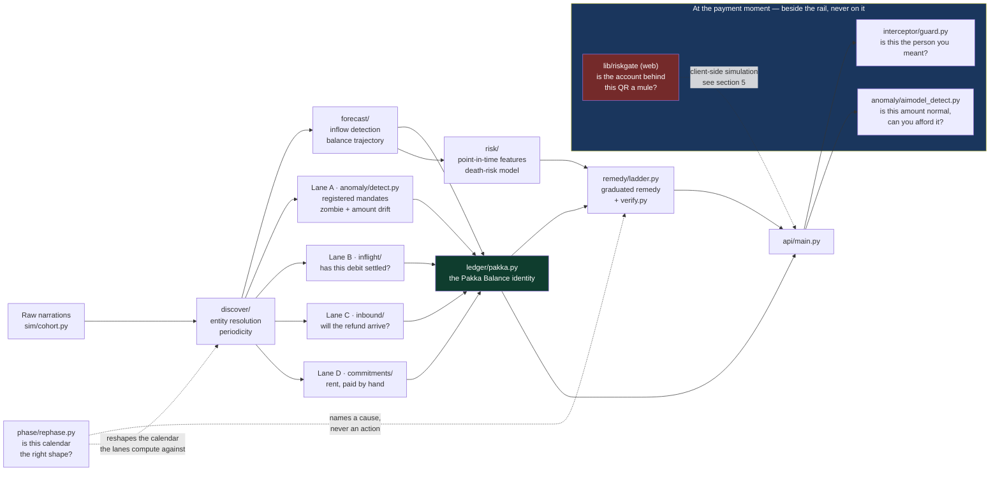
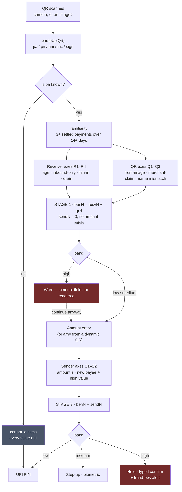

# Pakka — Architecture

Two halves, run together. A Python engine that answers questions about money
that has not moved yet, and a Next.js front end that asks them.

```
pakka/   Python 3.13 + FastAPI, uv-managed   → localhost:8011
web/     Next.js 16 + React 19 + Tailwind v4 → localhost:3000
```

This document is the system view. [CLAUDE.md](CLAUDE.md) is the working
agreement for editing it, [README.md](README.md) is the argument for why it
exists, and [anomaly_gate_decisions.md](anomaly_gate_decisions.md) is the
decision record for the high-value spend gate.

---

## Contents

1. [The shape of the whole thing](#1-the-shape-of-the-whole-thing)
2. [The four lanes, and the identity](#2-the-four-lanes-and-the-identity)
3. [Two things that are not lanes](#3-two-things-that-are-not-lanes)
4. [The three payment-moment gates](#4-the-three-payment-moment-gates)
5. [The QR scan beneficiary gate](#5-the-qr-scan-beneficiary-gate)
6. [Front end](#6-front-end)
7. [Invariants the tests defend](#7-invariants-the-tests-defend)
8. [What production would change](#8-what-production-would-change)

---

## 1. The shape of the whole thing

A statement goes in on the left. One number and a recommendation come out on
the right. Everything in between is either a lane that moves that number, or a
gate that stands beside it at the moment money is about to leave.



The dotted edges are the ones worth reading twice. The rephaser feeds the
ladder a *cause* and never an action; the QR gate runs in the browser and does
not call the API at all. Both are explained below.

---

## 2. The four lanes, and the identity

Your bank balance is a number about the past. Pakka Balance is what is left
once everything already committed is subtracted from it.

```
Pakka Balance  =  bank balance
                −  Lane A   registered mandates due before the next inflow
                −  Lane B   debits in flight that have not settled yet
                +  Lane C   inbound money that will arrive in time
                −  Lane D   recurring payments made by hand, in no register
```

| Lane | Module | The question |
|------|--------|--------------|
| **A** | `anomaly/detect.py` | Which registered mandates present before payday, and are any of them zombies or drifting in amount? |
| **B** | `inflight/` | Has this pending debit actually settled, or is it still coming? |
| **C** | `inbound/` | Will this refund land before the money is needed? |
| **D** | `commitments/` | What recurring payments does this person make by hand, that no mandate register knows about? |

**The identity is computed in [`ledger/pakka.py`](pakka/src/pakka/ledger/pakka.py),
never re-derived in the front end.** An earlier version summed historical
medians client-side; it was wrong, and it was wrong in the wrong layer.

**Lane A and Lane D must never carry the same series.** A series counted in
both subtracts the same money twice, so `is_commitment` treats
`DiscoveredSeries.is_mandate` as a hard exclusion. Relatedly, Lane D is not
gated on `DiscoveredSeries.confidence` — that score measures *mandate-ness*,
and rent scores low precisely because it is hand-paid.

---

## 3. Two things that are not lanes

**`risk/` + `remedy/`** — the death-risk model scores whether a mandate is
about to fail, and the ladder proposes the smallest intervention that prevents
it. `verify.py` builds the counterfactual by *shifting* `DebitEvent.scheduled_for`,
never by dropping the event: modelling a deferral as a deletion is what makes a
remedy look free and hides the collision it creates next cycle.

**`phase/rephase.py`** — asks whether the calendar itself is the wrong shape.
It is not a rung on the ladder and must not become one. A mandate cannot be
modified within 2 days of its next presentation, and the ladder fires inside
the 24-hour pre-debit window — so at the moment the ladder speaks, moving the
date is already illegal. A reschedule rung would be a button that cannot be
pressed. The ladder may *name* the structural cause via the optional
`rephase=` argument to `recommend()`; it may not offer it.

---

## 4. The three payment-moment gates

Three gates stand where money is about to leave. They ask different questions
and they stay separate on purpose — merging them would blur all three, and
each would end up tuned against the other's data.

| Gate | Where | The question | Model? |
|------|-------|--------------|--------|
| `interceptor/guard.py` | before confirm | Is this going to the person you meant? | No — deliberately |
| `anomaly/aimodel_detect.py` | before confirm | Is this amount normal for you, and can you afford it? | IsolationForest, capped |
| `web/src/lib/riskgate` | **at the QR scan** | Is the account behind this QR a mule account? | No — rules only |

**Why the interceptor refuses a model and the spend gate carries one.** A VPA
one character off one you pay every month is close to deterministic, and a
learned probability would only obscure it. Amount anomaly is the opposite case
— weak-signal, multivariate, dominated by interactions — and sits on the same
side of the line as the death-risk model. The QR gate lands with the
interceptor: account age, fan-in and drain speed are legible thresholds with
sentences attached, and a forest here would trade an explanation for nothing.

**None of them returns BLOCK.** Pakka sits beside the rail, not on it. The top
rung is a hold: an interstitial naming the reason, an explicit confirmation to
proceed, and an alert raised. An engine that returns BLOCK claims an authority
it does not have, and anyone who knows UPI will notice.

**Size and novelty are never the alarm on their own.** The spend gate's
high-value floor is an *entry condition*; the interceptor's novelty test is
too; and the QR gate's account-age test is the same shape. Rent is the
canonical case — a gate that flags the most predictable line in someone's
statement gets switched off within a week.

---

## 5. The QR scan beneficiary gate

**New.** [`web/src/lib/riskgate/`](web/src/lib/riskgate) — engine.
[`web/src/app/paytm2/screens/ScanScreen.tsx`](web/src/app/paytm2/screens/ScanScreen.tsx) — surface,
reached from the centre scan button on `/paytm2`.

### Why it fires at the scan

A UPI QR is a URL, and `pa` is the entire input a beneficiary check needs:

```
upi://pay?pa=quickpay88@okhdfcbank&pn=Sharma%20Stores&am=250.00&mc=5411&sign=…
          └─ VPA ────────────────┘  └─ claimed name ┘  └amt┘ └MCC┘ └signature┘
```

That is available the instant the camera decodes the frame — a full second
before the user has typed anything. A user who has scanned, typed ₹45,000 and
reached the PIN pad has *decided*; a warning there is an obstacle, and people
tap through obstacles. A warning 400ms after the scan, before any amount
exists, is information, and abandoning it is free.

So the gate runs in two stages, and on a `high` band at stage 1 the amount
field is never rendered.



### A second door: UPI Collect requests

Money can also leave through an *incoming* Collect request — someone else
asks, the user approves, and the requester gets paid. It is the same
beneficiary question through a different door, so it runs through the exact
same `decide()` with no logic added for it, but it needs its own entry point
for two reasons. First, a Collect request states its amount up front, so
there is no moment before an amount exists the way a scanned QR has one —
stage 1 does not apply, and the flow goes straight from the incoming-request
card to the stage-2 decision. Second, the fraud it demonstrates inverts the
money's direction from the QR case: *approving* a request sends the
requester money, it does not receive money on the approver's behalf, which
is the exact misunderstanding the scam depends on ("Paytm Cashback Team"
sends a Collect request for a refund that was never owed). The `high`-band
screen for a request says this explicitly, because the interstitial for a
QR ("cancel this payment") is the wrong verb for a request ("decline it").

`lib/riskgate/mock.ts` carries a small `REQUEST_CATALOGUE` alongside the QR
one for this — same `UpiQr` shape, an amount fixed on the entry rather than
left for the screen to ask, and a beneficiary account built the same way
every other mule in the cohort is (seeded ledger, `registeredName` distinct
from the claimed `pn`, which is what `Q3` catches on this door too).

### Nine axes

| | Axis | Fires when |
|---|------|-----------|
| **R1** | `newAccount` | account age < 60 days |
| **R2** | `inboundOnly` | ≥85% of activity is credits, over ≥8 transactions |
| **R3** | `highFanIn` | ≥15 distinct payers in 7 days |
| **R4** | `fastDrain` | median dwell < 10 min and ≥80% of 24h credits left again |
| **Q1** | `qrFromImage` | QR came from gallery/WhatsApp **and** ≥2 receiver signals |
| **Q2** | `merchantClaimMismatch` | QR carries an MCC but the VPA is not a registered merchant |
| **Q3** | `payeeNameMismatch` | the QR's `pn` ≠ the name the PSP resolves for that VPA |
| **S1** | `amountDeviation` | z ≥ 2.5 against the sender's own baseline |
| **S2** | `newPayeeHighValue` | never paid this VPA **and** ≥ ₹5,000 |

### The ladder

```
recvN = receiver axes fired, R2∧R3 counted once (one collector pattern)
qrN   = QR axes fired
benN  = recvN + qrN
sendN = sender axes fired, S1∧S2 counted once (one fact, not two)

low     if benN === 0
high    if benN + sendN >= 3
        OR (benN >= 2 AND (age < 60 OR R4 fired))
medium  if benN + sendN === 2
        OR (benN + sendN === 1 AND that signal is extreme)
low     otherwise
```

Four branches carry the whole design, and each of them exists because the
scenario suite failed without it:

- **`benN === 0` → `low`.** This gate escalates on *beneficiary* risk. Sender
  anomaly aggravates a beneficiary concern; it never creates one. An unusual
  amount to a payee of three years is the spend gate's question, and letting
  both modules answer it means two engines disagreeing on one screen.
- **`benN >= 2 AND new` reaches `high` with no sender signal.** In a well-run
  scam the sender looks completely normal — a real person calmly making a
  payment they believe in. A ladder that needed the victim to act strangely
  would miss exactly the cases that matter, and could not warn at stage 1 at
  all.
- **`OR R4 fired`** catches account takeover: an account paid for a year that
  now has forty payers a week and empties in five minutes is a mule *now*.
- **Familiarity redirects S1 to the payee baseline.** Rent of ₹18,000 against
  a ₹2,500 one-off baseline is z = 12.9. Without the redirect the gate fires
  on the most predictable line in the file, every month.

**R2 and R3 are suppressed for registered merchant VPAs over 180 days.**
Inbound-only and high fan-in *are* what a shop looks like. The age gate stays
because fake merchant onboarding is a real vector.

**Q1 is an amplifier and never an accusation.** People legitimately save a
friend's QR image; without its two-signal floor, a friend who opened an account
last month and sent their QR over WhatsApp lands at `medium`.

### Simulated, and where

`lib/riskgate/mock.ts` builds 15 beneficiaries and 4 senders from a seeded
PRNG, one stream per account, pinned to `OBSERVED_ON`. Ledger rows are
generated and the profile is *derived* from them, so every number the "Why?"
drawer prints is one the engine computed rather than one somebody typed.

The cohort exists to be a trap as much as a demo: three registered merchants
and two legitimately-new individuals are in it precisely because they are what
a naive version of this gate flags. `scenarios.ts` scores 21 cases — the
controls matter more than the positives, and the number to report is the
friction rate, not recall.

**On screen, this is guided-only — no free-form picker.** `ScanScreen.tsx`
offers exactly three named scenarios rather than exposing the full catalogue
for someone to drive by hand:

| Scenario | Door | What it shows |
|----------|------|----------------|
| "A fake ₹5,000 refund request" | Collect request | The reversed-money-flow scam above, played end to end |
| "Scan a fraudster's QR" | QR, stage 1 | A sticker pasted over the real one — `high` before an amount exists |
| "Same QR, different channel" | QR, stage 1 | One control stays live: *how did this QR reach you?* |

The third one exists to demonstrate `Q1` honestly rather than dramatically.
Every receiver in the cohort was checked against every source: `Q1` never
flips a verdict on its own, because it only counts once a beneficiary
already carries two other receiver-side flags — and by that point the
account is already at `high` regardless of source. So the scenario picks
"Quick Pay" (already `high` from its own ledger) and lets the source toggle
stay interactive: the band never moves, but the evidence panel gains
`Q1`'s line once the source isn't the camera. That is the amplifier design
working as specified, not a gap in it — a free-form QR-and-source picker
used to sit here making the same point for any catalogue entry; it is gone
now that one guided scenario makes it without asking anyone to drive the
whole catalogue themselves.

This gate runs **client-side and does not call the API**, unlike
`PayAnyoneScreen`, which asks the real interceptor over HTTP. The
interceptor's question is answered from *this* user's history, which the API
already holds; this gate's question is about the other side of the
transaction, and that beneficiary population has no home in `pakka/` yet.
Simulating it in `lib/` keeps the two honest about what they are — one reads a
real engine, one is a labelled simulation — and it means the scan flow
survives the backend being down.

---

## 6. Front end

The chrome lives in `app/layout.tsx`, mounted once. Pages must not mount
`<PaytmNav/>` themselves — every one of them used to, which is how a page
could silently end up with no navigation.

| Route | What it is |
|-------|-----------|
| `/` | landing page |
| `/demo` | the live engine, every lane at once |
| `/pitch` | the narrated pitch deck |
| `/sim` | the engine on a handset, stepped through as beats |
| `/paytm2` | Paytm 2.0 on a phone — the immersive concept, and where the scan gate lives |

Design system: Tailwind v4 plus CSS custom properties in `globals.css`. No raw
hex values anywhere; `--paytm-*`, `--color-*`, `--risk-*` for colour,
`--lift-1..4` for elevation, `--r-*` for radii. `/paytm2` additionally rides a
`--p2-*` set that has light and dark values, so its theme toggle relights the
whole handset from one attribute.

**A CSS module that animates a keyframe must declare that keyframe.** CSS
Modules rewrites `animation-name` to a per-file hash whether or not the file
declares it, so hoisting a shared `@keyframes` into `globals.css` silently
kills the animation.

---

## 7. Invariants the tests defend

These are the properties asserted against the whole cohort rather than a
fixture, because a safety property tested only where the data cooperates is
not being tested.

| Invariant | Where |
|-----------|-------|
| No series appears in both Lane A and Lane D | `tests/test_commitments.py` |
| The remedy ladder has no reschedule rung | `tests/test_phase.py` |
| The rephaser is fitted and scored on different months | `eval/phase.py` |
| The spend gate's model may raise a verdict one rung and never set one alone | `tests/test_aimodel.py` |
| A payee you pay regularly, at your usual amount, caps at `clear` | `tests/test_aimodel.py` |
| No probability is attached to a landing beyond the horizon | `LandingPoint.scored` |
| Published figures match the prose in README and the decks | `tests/test_published_numbers.py` |
| Every spoken figure has a clip that says it | `tests/test_narration.py` |
| **21 scan-gate scenarios, controls included** | `lib/riskgate/scenarios.ts` |

The last one is the new module's equivalent, and its five recorded failures are
in the file header — each one changed the ladder rather than the expectation.

---

## 8. What production would change

The decision logic is the portable part. Production moves the feature
computation off the request path and changes almost nothing else.

| Here | Production |
|------|-----------|
| `buildReceiverProfile()` scanning an array at scan time | Flink over a Kafka transaction stream, writing counters to Redis |
| Mock ledger in a TS object | Redis Enterprise, sender + receiver shards, async parallel lookup under 5ms |
| `decide()` in the browser | Go/Rust risk orchestrator behind an Envoy/Kong gateway — same ladder, same constants |
| The spend gate's IsolationForest in sklearn | XGBoost + IsolationForest via ONNX on Triton, same capped role |
| `sign` parsed but not verified | Verified against the acquirer's key — an unverifiable signature on a merchant-claiming QR is stronger than Q2 alone |
| Our own mule labels | NPCI-level cross-PSP beneficiary signals |

**What a hackathon cannot simulate, and we do not fabricate:** cross-PSP
beneficiary reputation, device-binding and SIM-swap recency, and graph features
over the transfer network. Fan-in is a one-hop shadow of the last of these.
They are named in the pitch as what this becomes on real rails; they are not
in the code pretending to be there.
